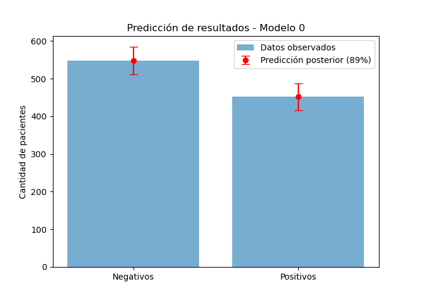
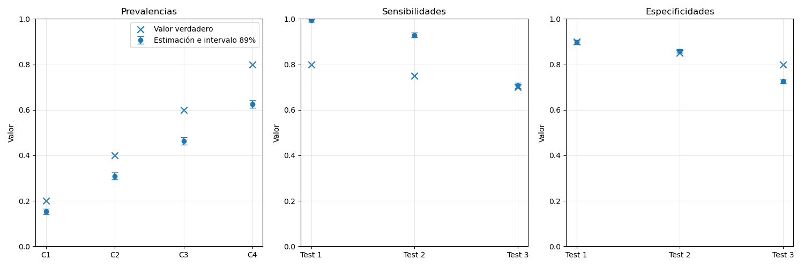
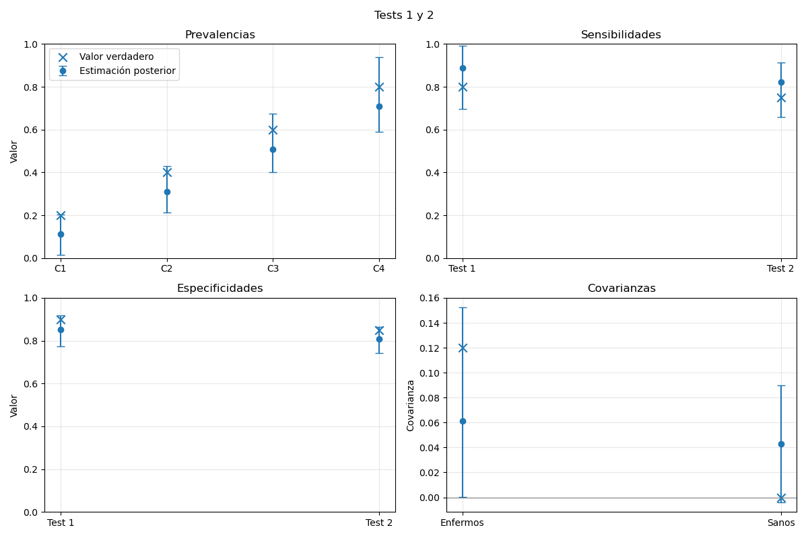
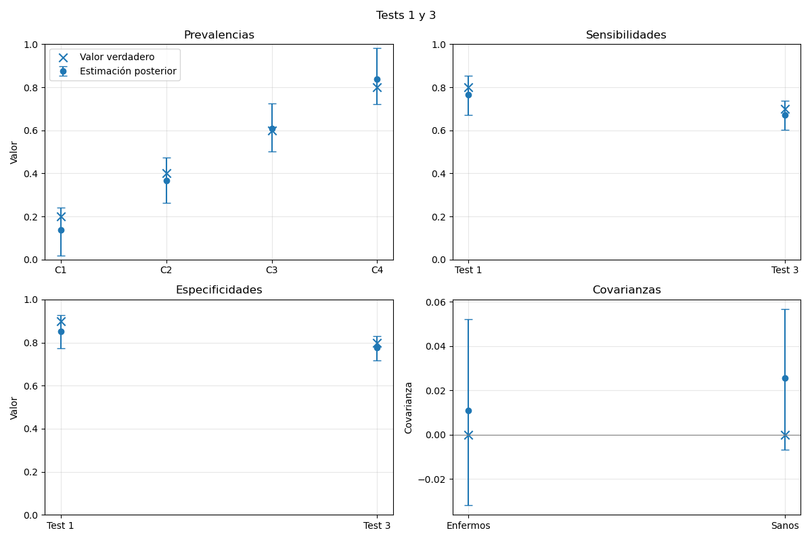
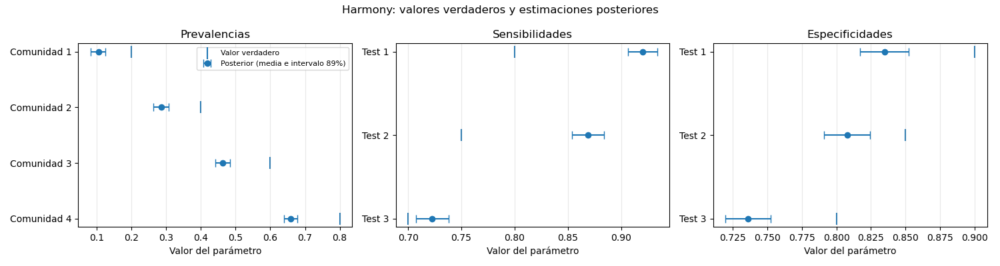
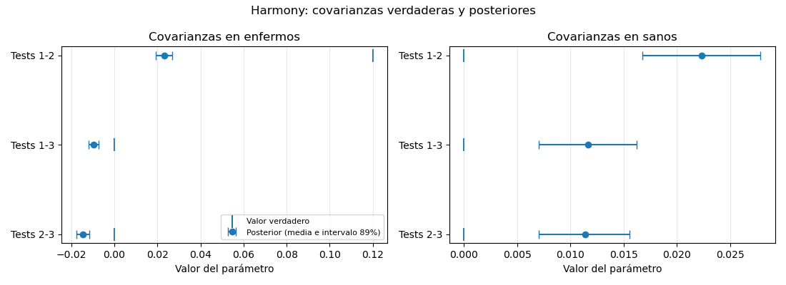

# Modelo 0:

## Parámetros verdaderos:
### p | prevalencia de la enfermedad
### s | sensibilidad del test
### x | especificidad del test

### Probabilidad de test positivo: q_1 = p*s + (1-p)(1-x)
### Probabilidad de test negativo: q_0 = 1 - q_1

## Conclusiones:
### No parecen haber problemas de Muestreo, el modelo converge correctamente
### Como era de imaginar... el modlo estima correctamente 'q1' (probabilidad de que el test dé positivo),
### mientras que p, s y x tienen intervalos muy amplio; sin poder identificar sus efectos por separado.

# Modelo 1:

### Para este modelo contamos con 3 tests y 4 comunidades.
### Se determinan 8 resultados posibles, segun los test para cada paciente:
### 000, 001, 010, 011, 100, 101, 110, 111

## El modelo busca estimar:

### pc: Prevalencia de cada comunidad
### st: Sensibilidad de cada test
### xt: Especificidad de cada test

### Para este modelo existe un supuesto fundamental de independencia condicional entre los test.

## Conclusiones:
### El modelo converge correctamente, dado que los parametros tienen un r_hat = 1 y muestras efectivas suficientes...
### Se puede observar en los graficos como el modelo genera 4 estimaciones que subestiman los valores verdaderos de las prevalencias.
### Para los test 1 y 2, el modelo sobrestima considerablemente sus estimaciones de Sensibilidad.
### No parece haber problemas en la estimación de Especificidades de los test.

# Modelo 2:

### A diferencia del anterior, en este modelo ya no suponemos que los tests son condicionalmente independientes.
### Dendukuri agrega dos parámetros que permiten representar la dependencia entre un par de tests:
### cs: covarianza entre los resultados positivos de ambos tests en individuos enfermos
### cx: covarianza entre los resultados negativos de ambos tests en individuos sanos

### Considero covarianzas comunes entre las cuatro comunidades y prevalencia distinta según la comunidad.
### Como teniamos antes podemos diferenciar los resultados por patrones: 00, 01, 10, 11

### La probabilidad de observar un patrón para este modelo es:
### qc = p_c * [(1 - s_a)(1 - sb) + cs]   +   (1 - pc)[xa*xb + cx]

## Conclusiones:
### El modelo converge correctamente, se observa un r_hat correcto en los parametros y las muestras efectivas (aunque podrian ser más) son suficientes...

### En General:
### Las Prevalencias siguen siendo subestimadas.
### La estimación de Sensibilidades mejoraron respecto al modelo 1, pero se siguen sobreestimando.
### La estimación de Especificidades no se encuentran tan lejos de los valores verdaderos.
### Las covarianzas no se estiman con precisión, aunque su intervalo contiene el valor verdadero.

### En particular: el modelo aplicado en los test 1 y 3 estiman correctamente todos los parámetros.

# Modelo 3:

### Harmony plantea entender todas las relaciones entre test (y no unicamente de 2 en 2), incorporando las covarianzas de los 3 pares posibles (para 3 test)
### Para cada comunidad, la probabilidad de observar un patrón combina 2 posibilidades:
### 1. Que el individuo esté enfermo, ponderada por la prevalencia.
### 2. Que esté sano, ponderada por 1 - (la prevalencia).

### El problema de Harmony es que contabiliza dos veces la covarianza, lo que representa un problema para las estimaciones del modelo.

## Conclusiones:
### Se consiguió una buena convergencia ya que el modelo obtuvo 0 divergencias, un R-hat máximo de 1.0019 y tamaños efectivos de muestra superiores a 1300.
### Las prevalencias y especificidades fueron subestimadas respecto de sus valores verdaderos; mientras que las sensibilidades resultaron sobrestimadas.
### Esto significa que Harmony no logra recuperar correctamente los parámetros con los que se generaron los datos.